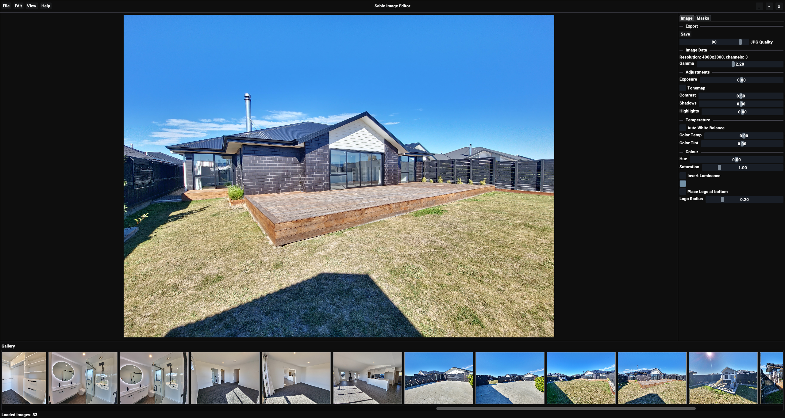
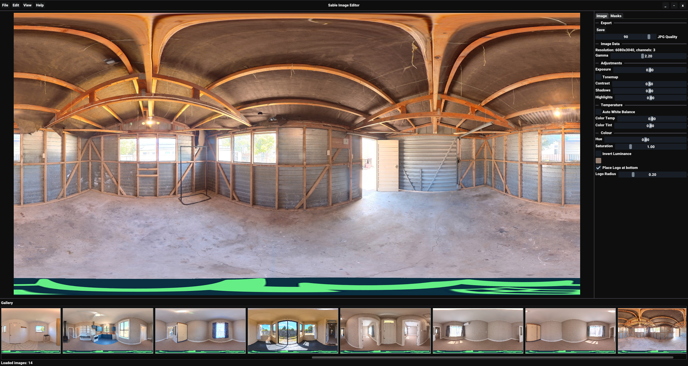
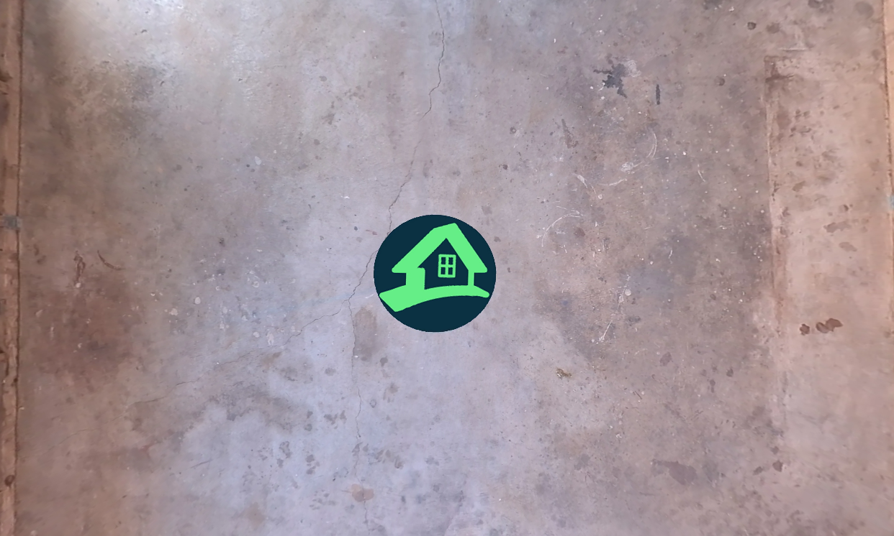

# Image editor
A simple hardware-accelerated image editor with multiple post processing techniques and masked-based editing.

# Previews

### Supports custom logo on 360 images

### Ground view of unwrapped 360 image


# Building
```bash
git clone --recursive https://github.com/oliwilliams1/Image-editor
cd Image-editor
mkdir build
cd build
cmake ..
```
This will generate build files that you can build with your own build chain (msvc, make, Xcode...)